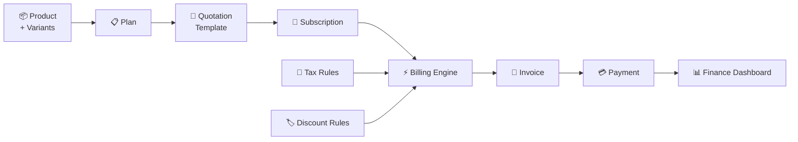
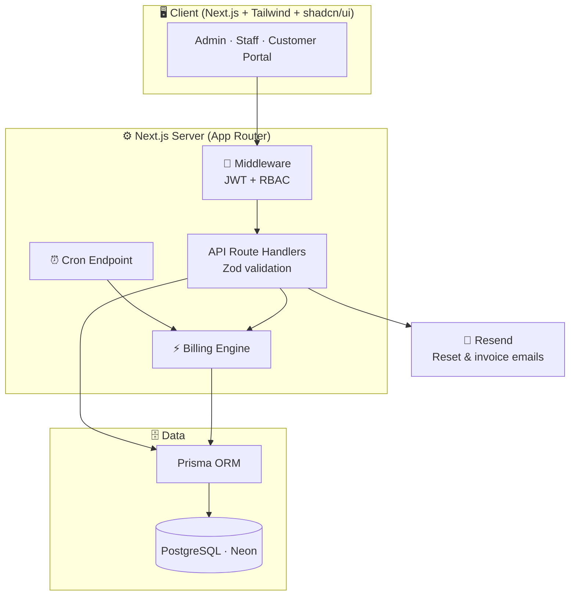
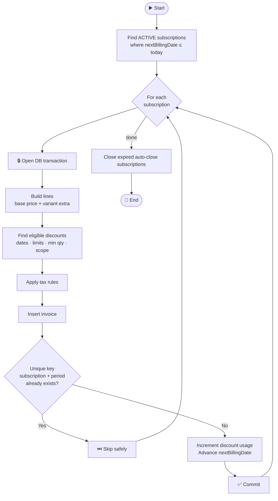
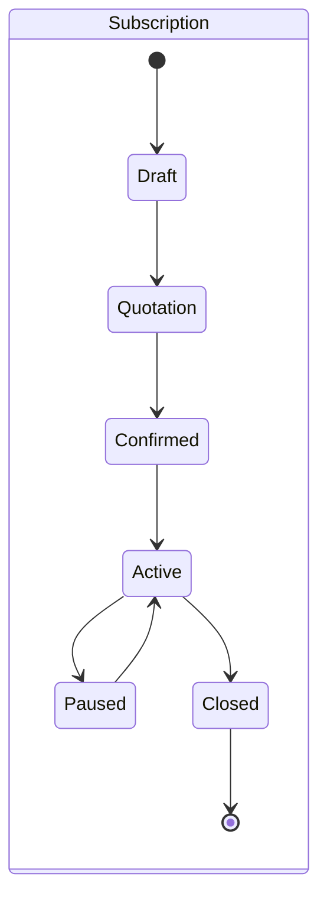
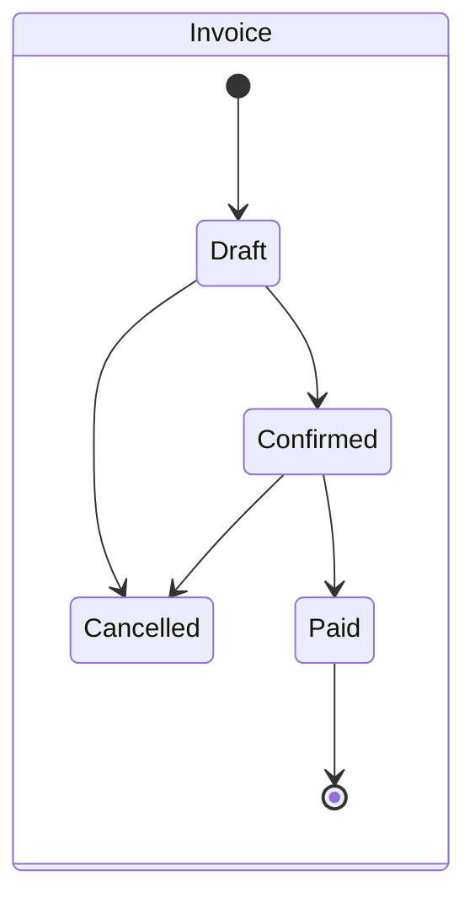
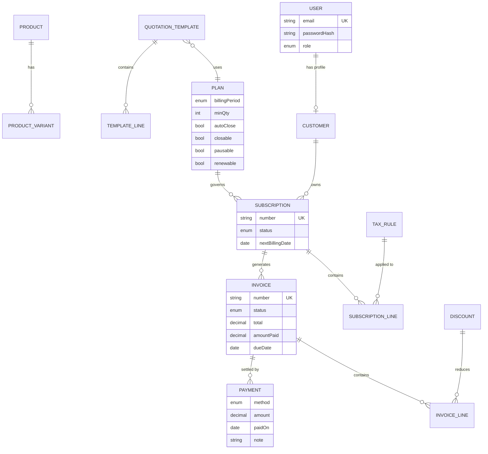

<div align="center">

# 🔁 Brightloop Subscription Management System

### *One platform to run plans, subscriptions and recurring billing, end to end.*

<br/>


[🌐 Live Demo](#) · [🎥 Demo Video](#) · [📑 Problem Statement](#-the-problem) · [🏗️ Architecture](#%EF%B8%8F-architecture) · [🚀 Getting Started](#-getting-started)

</div>

---

## 📖 Table of Contents

- [✨ Overview](#-overview)
- [🎯 The Problem](#-the-problem)
- [💡 Our Core Idea](#-our-core-idea)
- [🧩 Features](#-features)
- [🏗️ Architecture](#%EF%B8%8F-architecture)
- [🔐 Roles & Access](#-roles--access)
- [⚙️ The Billing Engine](#%EF%B8%8F-the-billing-engine)
- [🗄️ Data Model](#%EF%B8%8F-data-model)
- [🧰 Tech Stack](#-tech-stack)
- [📂 Project Structure](#-project-structure)
- [🚀 Getting Started](#-getting-started)
- [🧪 Testing Checklist](#-testing-checklist)
- [⏱️ Build Plan](#%EF%B8%8F-build-plan)
- [🗺️ Roadmap](#%EF%B8%8F-roadmap)
- [👥 Team](#-team)

---

## ✨ Overview

**Brightloop Software** earns its money every month, not just once. Business software billed monthly or yearly, add-ons switched on and off, products in multiple variants. Behind the scenes, though, subscriptions live in a spreadsheet, renewals depend on someone remembering, and invoices are typed by hand.

This project is the **digital backbone** that replaces all of that:

> 🧾 **Set up products & plans** → 📝 **Create subscriptions** → ⚡ **Auto-generate invoices** → 💳 **Collect payments** → 📊 **Report revenue**

---

## 🎯 The Problem

| 🗂️ Task | 😵 How it works today | 💥 The result |
|---|---|---|
| Customer subscriptions | Tracked in a spreadsheet | No single source of truth |
| Renewals | Remembered by whoever notices first | Missed renewals, lost revenue |
| Invoices | Typed up by hand every month | Wrong amounts, wasted hours |
| Payments | Matched by scrolling bank statements | Slow, error-prone reconciliation |
| Revenue reports | Built manually each quarter | Takes days; nobody knows the real MRR |

**Nobody at the company can say how much recurring revenue they actually have.**

### 🎬 A Month at Brightloop: the seven scenes we solve

| # | Scene | What the system must do |
|:-:|---|---|
| 1️⃣ | **A new customer signs up** | Secure signup, password rules, reset link, role-based access |
| 2️⃣ | **Launching a new plan** | Products, price-changing variants, plans with billing periods and rules |
| 3️⃣ | **Quote → subscription** | Quotation templates, numbered subscriptions, full status flow |
| 4️⃣ | **Billing day** | Auto-generated invoices with taxes, **never twice, never skipped** |
| 5️⃣ | **A customer asks for a better price** | Admin-only discount rules that apply themselves |
| 6️⃣ | **The money comes in** | Record payments against invoices, see paid vs outstanding |
| 7️⃣ | **Finance lead, month-end** | One dashboard: active subs, revenue, owed, overdue, under 2 s |

---

## 💡 Our Core Idea

> **A subscription is a contract. A billing engine reads the contract and produces invoices automatically, exactly once. Payments close invoices, and every number on the dashboard is derived from those records.**



### 🏆 Three principles we build around

1. **🛡️ Idempotent billing.** Running billing twice produces the same result. A database-level unique constraint makes double-billing impossible.
2. **🤖 Automation over memory.** Taxes, discounts, invoices and renewals happen by rule, not by someone remembering.
3. **⚡ Derived truth.** Overdue, outstanding and revenue are *computed* from invoices and payments, so they can't go stale.

---

## 🧩 Features

<details open>
<summary><b>🔑 Authentication & Access</b></summary>

- ✅ Signup with **unique email** per account
- ✅ Password policy: **more than 8 characters**, with uppercase, lowercase and a special character
- ✅ **Forgot password** with a time-limited reset link sent to the registered email
- ✅ Role-based access: **Admin / Staff / Customer**
- ✅ Only the **Admin** can add staff members

</details>

<details>
<summary><b>📦 Products, Variants & Plans</b></summary>

- ✅ Products with name, type, sales price, cost price and notes
- ✅ **Variants** that adjust price (e.g. brand *Odoo* → **+560**)
- ✅ Plans with price, billing period (**daily / weekly / monthly / yearly**), minimum quantity and availability dates
- ✅ Per-plan behaviour set by the admin: **auto-close · closable · pausable · renewable**

</details>

<details>
<summary><b>📝 Quotations & Subscriptions</b></summary>

- ✅ **Quotation templates** with preset plan and product lines, valid for N days
- ✅ Auto-numbered subscriptions (`SUB-0001`) with customer, plan, start/expiry dates and payment terms
- ✅ Line items: product, quantity, unit price, taxes, amount
- ✅ Visible lifecycle: **Draft → Quotation → Confirmed → Active → Closed**

</details>

<details>
<summary><b>🧾 Invoicing</b></summary>

- ✅ One-click **bulk generation** from due subscriptions
- ✅ Customer details, lines, taxes and totals **pre-filled**
- ✅ **Automatic tax** from admin-defined rules
- ✅ Confirm · Cancel · Send · Print
- ✅ Lifecycle: **Draft → Confirmed → Paid**

</details>

<details>
<summary><b>🏷️ Discounts</b></summary>

- ✅ **Admin-only** rules: fixed amount or percentage
- ✅ Minimum purchase / quantity, start and end dates, **usage limit**
- ✅ Applies to specific products **or** whole subscriptions
- ✅ **Auto-applied** on the next invoice; stops on expiry or when exhausted

</details>

<details>
<summary><b>💳 Payments & 📊 Reporting</b></summary>

- ✅ Record payments with **method, amount, date and note**, against the right invoice
- ✅ Partial payments supported; invoice flips to **Paid** automatically
- ✅ Paid vs outstanding views, **overdue** list for chasing
- ✅ Finance dashboard: active subscriptions, revenue, payments, overdue, with **filters and summary charts**
- ✅ Every page **under 2 seconds** at thousands of records

</details>

<details>
<summary><b>👤 Customer Portal & 📱 Responsiveness</b></summary>

- ✅ Customers see **only their own** subscriptions, invoices and payments
- ✅ Fully **mobile responsive**, tested down to 375 px

</details>

---

## 🏗️ Architecture



**Why this shape?** One repo, one deploy, no CORS, and the billing logic stays in a single testable module that both the cron job and the admin's *Run billing* button call.

---

## 🔐 Roles & Access

| Capability | 👑 Admin | 🧑‍💼 Staff | 🙋 Customer |
|---|:-:|:-:|:-:|
| Add staff members | ✅ | ❌ | ❌ |
| Products, variants, plans | ✅ | 👁️ view | ❌ |
| Tax rules | ✅ | ❌ | ❌ |
| Discount rules | ✅ | ❌ | ❌ |
| Quotation templates | ✅ | ✅ | ❌ |
| Create / manage subscriptions | ✅ | ✅ | ❌ |
| Generate & manage invoices | ✅ | ✅ | ❌ |
| Record payments | ✅ | ✅ | ❌ |
| Finance dashboard | ✅ | ✅ | ❌ |
| Own subscriptions & invoices | ✅ | ✅ | ✅ *(own only)* |

> 🔒 Enforced twice: in **middleware** (route level) and by a `requireRole()` guard inside **every API handler**. Customer queries are always scoped to the logged-in customer.

---

## ⚙️ The Billing Engine

The heart of the system. Runs from the **daily cron** or the admin's **Run billing now** button.



### 🛡️ Guarantees

| Requirement | How we guarantee it |
|---|---|
| **Never billed twice** | `UNIQUE (subscriptionId, periodStart)` on invoices, enforced by the database |
| **Never skipped** | Catch-up loop bills every missed period, in order |
| **Discounts apply on their own** | Evaluated at generation time; usage counter incremented in the same transaction |
| **Atomicity** | Invoice, discount usage and next billing date commit together, or not at all |

### 🔄 State machines





> ⏰ **Overdue is computed, not stored:** `status = CONFIRMED AND dueDate < today AND amountPaid < total`.

---

## 🗄️ Data Model



**⚡ Performance:** indexes on `Invoice(status, dueDate)`, `Invoice(customerId)`, `Subscription(status, nextBillingDate)` and `Payment(paidOn)`, plus server-side pagination and aggregate queries, keep every page under **2 seconds**.

---

## 🧰 Tech Stack

| Layer | Technology | Why |
|---|---|---|
| 🖼️ Framework | **Next.js 14 (App Router) + TypeScript** | Frontend and API in one repo, one deploy |
| 🎨 UI | **Tailwind CSS + shadcn/ui** | Responsive, accessible components, fast to build |
| 📈 Charts | **Recharts** | Dashboard summary views |
| 🗄️ Database | **PostgreSQL (Neon)** | Transactions, constraints and joins that billing needs |
| 🔗 ORM | **Prisma** | Typed schema, migrations, seeding |
| 🔐 Auth | **JWT (httpOnly cookie) + bcrypt** | Full control over password rules and roles |
| ✅ Validation | **Zod** | One schema shared by form and API |
| 📧 Email | **Resend** | Password reset and invoice delivery |
| ⏰ Scheduler | **Vercel Cron** | Automated daily billing run |
| 🚀 Hosting | **Vercel + Neon** | Zero-config HTTPS deploys |

---

## 📂 Project Structure

```
brightloop/
├── prisma/
│   ├── schema.prisma          # Data model
│   └── seed.ts                # Demo data (admin, staff, customers, ~2k subscriptions)
├── src/
│   ├── app/
│   │   ├── (auth)/            # login · signup · forgot/reset password
│   │   ├── (dashboard)/       # admin & staff area
│   │   │   ├── products/  plans/  taxes/  discounts/
│   │   │   ├── templates/  subscriptions/
│   │   │   ├── invoices/  payments/
│   │   │   └── reports/       # finance dashboard
│   │   ├── portal/            # customer portal
│   │   └── api/               # route handlers
│   │       └── cron/billing/  # scheduled billing endpoint
│   ├── lib/
│   │   ├── billing/           # ⚡ billing engine, tax & discount calculators
│   │   ├── auth/              # JWT, RBAC guards, password policy
│   │   ├── state/             # subscription & invoice state machines
│   │   └── validators/        # Zod schemas
│   └── components/            # shared UI
├── vercel.json                # cron schedule
└── README.md
```

---

## 🚀 Getting Started

### 📋 Prerequisites

- Node.js **18+**
- A PostgreSQL database (a free [Neon](https://neon.tech) project works)
- A [Resend](https://resend.com) API key *(optional locally: reset links are logged to the console as a fallback)*

### 🛠️ Setup

```bash
# 1. Clone
git clone https://github.com/<your-username>/<your-repo>.git
cd <your-repo>

# 2. Install
npm install

# 3. Configure environment
cp .env.example .env

# 4. Create tables and seed demo data
npx prisma migrate dev
npx prisma db seed

# 5. Run
npm run dev
```

Open **http://localhost:3000** 🎉

### 🔧 Environment variables

| Variable | Purpose |
|---|---|
| `DATABASE_URL` | PostgreSQL connection string |
| `JWT_SECRET` | Secret for signing session tokens |
| `RESEND_API_KEY` | Email delivery for reset links and invoices |
| `APP_URL` | Base URL used in email links |
| `CRON_SECRET` | Protects the billing cron endpoint |

### ☁️ Deploy

1. Push the repo to GitHub and import it into **Vercel**.
2. Add the environment variables above.
3. Run `npx prisma migrate deploy` and the seed against the production database.
4. Vercel Cron picks up `vercel.json` and calls `/api/cron/billing` on schedule.

---

## 🧪 Testing Checklist

- [ ] ♻️ Run billing **twice**: the invoice count must not change the second time
- [ ] 🏷️ Create a discount, bill, and confirm it appears on the invoice; exhaust its limit and confirm it stops
- [ ] 🔒 As a customer, open another customer's invoice URL: must be denied
- [ ] 🚫 As staff, open the discount page: must be denied
- [ ] 💳 Pay one invoice in two partial payments: it flips to **Paid**
- [ ] 🔑 Password rules rejected correctly; duplicate email rejected
- [ ] 📱 Every page usable at **375 px** width
- [ ] ⚡ Dashboard loads in **under 2 s** on the seeded dataset

---

## ⏱️ Build Plan

The hackathon is **8 hours**. We target a **fully deployed, working build in 6**, leaving 2 hours for polish and extras.

| ⏰ Time | 🎯 Goal | 📦 Deliverable |
|---|---|---|
| **0:00 – 0:30** | Setup | Repo, DB, Prisma schema, **empty app deployed** |
| **0:30 – 1:15** | Auth & RBAC | Signup, login, reset flow, roles, seeded admin |
| **1:15 – 2:15** | Catalog | Products, variants, plans, taxes, discounts, staff |
| **2:15 – 3:15** | Subscriptions | Templates, subscriptions, status flow |
| **3:15 – 4:15** | ⚡ Billing & invoices | Idempotent engine, invoice actions, cron |
| **4:15 – 4:45** | Payments | Recording, auto-paid, overdue views |
| **4:45 – 5:30** | Dashboard & portal | KPIs, charts, filters, customer portal |
| **5:30 – 6:00** | Seed, polish, test | 2k-row seed, mobile pass, final deploy |
| **6:00 – 8:00** | 🎁 Buffer | Bug fixes, extras, demo prep |

---

## 🗺️ Roadmap

**Core (must ship)**
- [ ] Auth, roles and password reset
- [ ] Products, variants and plans
- [ ] Quotation templates and subscriptions
- [ ] Idempotent billing engine with tax and discounts
- [ ] Invoices and payments
- [ ] Finance dashboard and customer portal
- [ ] Mobile responsive and deployed

**Stretch goals ✨**
- [ ] Proration on mid-cycle changes
- [ ] Automated dunning (overdue reminder emails)
- [ ] CSV / PDF export of reports
- [ ] MRR / churn trend charts
- [ ] Dark mode
- [ ] Audit log of status changes

---

## 👥 Team

| 👤 Name | 🛠️ Role | 🔗 Links |
|---|---|---|
| *Your Name* | Full-stack | [GitHub](#) · [LinkedIn](#) |
| *Teammate* | Backend | [GitHub](#) · [LinkedIn](#) |
| *Teammate* | Frontend | [GitHub](#) · [LinkedIn](#) |

---

<div align="center">

### 🔁 *Bill the right people, the right amount, at the right time, and prove it with numbers.*

Built with ☕ and ⚡ for the hackathon

⭐ **Star this repo if you like it!** ⭐

</div>
